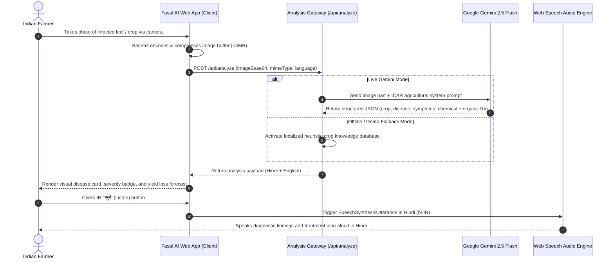
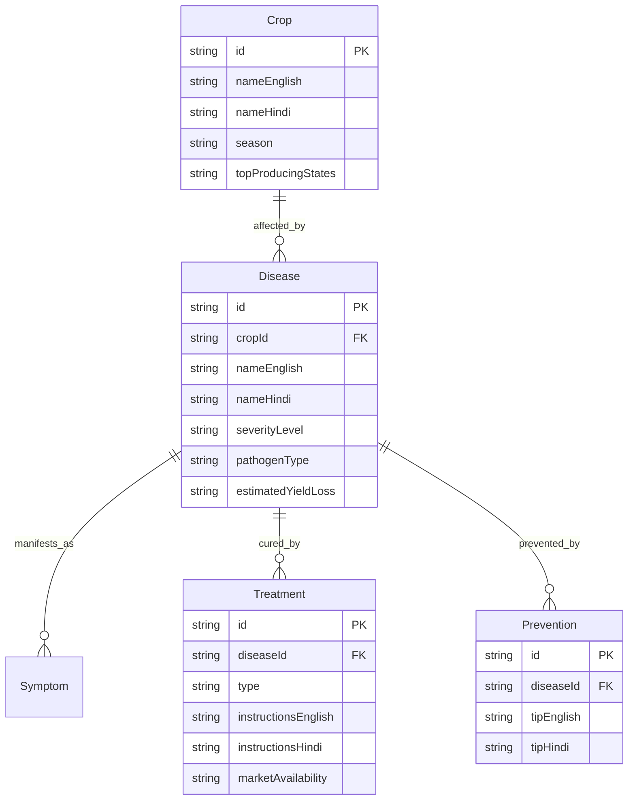

# 📐 Fasal AI (फसल AI) — Technical Design Document (TDD)
**Architecture Specification, Data Pipeline & Edge-to-Cloud System Design**  
*Viksit Bharat Young Leaders Dialogue (VBYLD) 2027 — Hack for Social Cause*  
*Thematic Focus: Rural Development & Livelihoods | AI, GIS & Emerging Technologies*

---

## 1. System Overview

**Fasal AI** is an AI-powered crop health monitoring and disease diagnosis Progressive Web App (PWA) designed specifically for India's 600 million farmers and rural agricultural communities.

### Core Architectural Pillars
1. **Low-Latency Vision Diagnostics**: Google Gemini 2.5 Flash multimodal vision pipeline for zero-lag crop disease detection from standard mobile camera snapshots.
2. **Vernacular Accessibility & Multimodal Output**: Instant dual-language (Hindi Devanagari & English) diagnosis with browser-native text-to-speech voice narration for semi-literate users.
3. **Dual Treatment Architecture**: Simultaneous output of modern chemical therapeutics and low-cost indigenous organic/home remedies (Neem, turmeric, cow urine, crop rotation).
4. **Zero-App-Store Footprint**: Lightweight (<1MB initial load) Progressive Web App with offline-capable caching and demo fallback modes.
5. **Direct Agricultural Escalation**: Direct one-tap escalation to the national **Kisan Call Centre (1800-180-1551)** and Krishi Vigyan Kendra (KVK) network.

---

## 2. End-to-End System Architecture

```mermaid
graph TB
    subgraph Client_Layer ["Farmer & Field Device Tier (PWA)"]
        Mobile[Farmer Smartphone / CSC Tablet]
        CameraUI[Web Camera Capture & Drag-and-Drop]
        VoiceSynth[Web Speech Synthesis API (Hindi TTS)]
        LangEngine[Bilingual Render Engine (English / हिन्दी)]
    end

    subgraph CDN_Gateway ["Edge & Routing Layer"]
        NextRouter[Next.js 15 App Router / Edge Functions]
        PWA_Cache[Service Worker / PWA Offline Manifest]
    end

    subgraph Core_Services ["Fasal AI Application Tier"]
        AnalyzeSvc["/api/analyze (Image Pre-processor & Triage)"]
        CropsDB["/api/crops (Indian Crop Knowledge Base)"]
        FallbackEngine["Local Heuristic & Offline Demo Engine"]
    end

    subgraph AI_Intelligence ["Multimodal Generative AI Tier"]
        GenAIClient["@google/genai SDK v2.22"]
        GeminiFlash["Google Gemini 2.5 Flash Vision Model"]
        StructuredPrompt["ICAR-Trained Agricultural Prompt Schema"]
    end

    subgraph External_Services ["National Agro Rails & Escalation"]
        KCC["Kisan Call Centre (1800-180-1551)"]
        KVK["Krishi Vigyan Kendra (District Agricultural Officers)"]
    end

    Mobile --> CameraUI
    CameraUI --> NextRouter
    VoiceSynth --> Mobile
    LangEngine --> Mobile
    PWA_Cache <--> Mobile

    NextRouter --> AnalyzeSvc
    NextRouter --> CropsDB

    AnalyzeSvc --> GenAIClient
    GenAIClient --> GeminiFlash
    GeminiFlash --> StructuredPrompt
    StructuredPrompt --> AnalyzeSvc

    AnalyzeSvc -.->|On Offline / API Error| FallbackEngine
    
    Mobile -.->|One-Tap Escalation| KCC
    Mobile -.->|Field Advisory| KVK
```

---

## 3. Data Flow & Sequence Diagram



---

## 4. Database & Knowledge Base Entity Model



---

## 5. Security, Privacy & Low-Bandwidth Optimizations

1. **Zero Media Persistence (Privacy by Design)**: Uploaded crop images are processed in-memory as Base64 strings and are **never saved** to persistent server disks, ensuring total farmer privacy and zero storage costs.
2. **Ephemeral AI Buffers**: The Google Gemini API payload is processed ephemerally without training retainment on private user data.
3. **Bandwidth Throttling Resilience**: The entire application bundle is under 1MB. Works seamlessly on spotty 2G/3G connections common in rural farming belts.
4. **Demo Mode Fail-Safe**: If a farmer or hackathon judge lacks an active internet connection or API quota, the system falls back to high-fidelity localized crop models without crashing.

---

*Fasal AI Technical Design Document — Prepared for VBYLD 2027 Evaluation Jury.*
