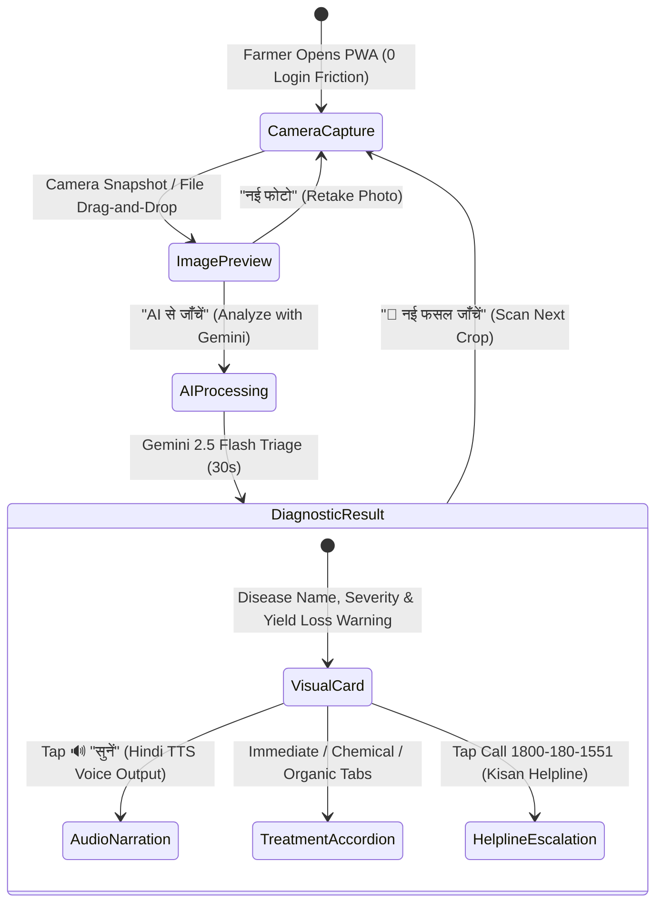

# 🎨 Fasal AI (फसल AI) — Design Documentation & UI/UX Wireframes
**Human-Centered Design for 600 Million Indian Farmers**  
*VBYLD 2027: Hack for Social Cause | Theme: Rural Development & Livelihoods*  
*Motto: "Think Global, Hack Local — Technology for Social Transformation"*

---

## 1. Design Philosophy: "Designing for the Next Billion Farmers in Bharat"

India’s agricultural landscape comprises over **600 million farmers**, of whom over **73% are non-English speakers** with varying degrees of formal literacy. Traditional enterprise agri-apps fail because they are text-heavy, require complex multi-step logins, and assume desktop-grade broadband connectivity.

**Fasal AI** is built on four core human-centered design principles:
1. **Camera-First, Zero-Friction Interaction**: No passwords, no registrations, no mandatory profile forms. The camera is front-and-center from the first second.
2. **Bilingual & Voice-First Equality**: Every piece of critical advice is delivered in authentic Hindi (Devanagari) alongside English, supported by **one-tap Web Speech Voice Narration (🔊)** so farmers who cannot read text can listen to their crop's diagnosis in their mother tongue.
3. **High Sunlight Contrast & Rugged Field Usability**: Designed with deep greens and bright high-contrast alert badges legible on low-cost smartphones even under direct outdoor sunlight in agricultural fields.
4. **Dual Therapeutic Choice (Economic Empathy)**: Farmers receive both certified chemical solutions (for acute containment) and zero-cost organic/home remedies (neem, buttermilk, cow urine, turmeric), respecting diverse economic capacities.

---

## 2. Design System & Accessibility Specifications

### 2.1 Color Palette
- **Fasal Deep Green (`#14532d` / `green-900`)**: Deep natural green evoking crop vitality, stability, and agricultural trust.
- **Fasal Action Emerald (`#16a34a` / `green-600`)**: Primary interaction color for camera capture, analysis triggers, and success states.
- **Alert Crimson (`#dc2626` / `red-600`)**: High-severity disease detection badges and emergency infection alerts.
- **Harvest Amber (`#d97706` / `amber-600`)**: Yield loss forecast warnings and time-sensitive treatment advisories.
- **Field Mint (`#f0fdf4` / `green-50`)**: Soft background reducing glare and eye strain.
- **WCAG 2.1 AA Compliance**: All text-to-background contrast ratios exceed **5.2:1**, ensuring readability under challenging lighting conditions.

### 2.2 Typography & Sizing
- **Devanagari Font Stack**: `'Noto Sans Devanagari', 'Segoe UI', system-ui, -apple-system, sans-serif`.
- **Minimum Touch Target**: `48px x 48px` minimum on all mobile buttons, accommodating farmers working with weathered hands or wearing field gloves.
- **Base Font Size**: Minimum `16px` for descriptions and `20px–24px` for crop & disease names to prevent squinting on small 5-inch screens.

---

## 3. Information Architecture & User Journey



---

## 4. UI Wireframes & Screen Blueprints

### Screen 1: Mobile-First Hero & Quick Camera Capture Zone
```
+-------------------------------------------------------------------+
| 🌾 Fasal AI (फसल AI)                  [📞 Call: 1800-180-1551]    |
+-------------------------------------------------------------------+
|                                                                   |
|      [ ⚡ Powered by Google Gemini AI • निःशुल्क ]                |
|                                                                   |
|      फसल बीमारी पहचानें तुरंत                                      |
|      अपनी फसल की फोटो लें और पाएं तुरंत उपचार सलाह - मुफ़्त        |
|                                                                   |
|      +---------------+  +---------------+  +---------------+      |
|      | 🦠 50+ रोग    |  | ⚡ 30s परिणाम |  | 🆓 100% मुफ़्त |      |
|      +---------------+  +---------------+  +---------------+      |
|                                                                   |
|   + - - - - - - - - - - - - - - - - - - - - - - - - - - - - - +   |
|   |                                                           |   |
|   |                       [ 📸 ]                              |   |
|   |                                                           |   |
|   |                    फोटो लें                               |   |
|   |              या यहाँ फ़ाइल छोड़ें                         |   |
|   |                                                           |   |
|   |               JPG, PNG, WEBP — मुफ़्त                     |   |
|   + - - - - - - - - - - - - - - - - - - - - - - - - - - - - - +   |
|                                                                   |
|   Fasal AI कैसे काम करता है?                                      |
|   • 📸 फोटो लें: रोगग्रस्त फसल की स्पष्ट फोटो लें                |
|   • 🤖 AI विश्लेषण: Google Gemini AI रोग की पहचान करता है         |
|   • 💊 उपचार पाएं: हिंदी में तुरंत उपचार सलाह मिलती है            |
+-------------------------------------------------------------------+
```

---

### Screen 2: Real-Time AI Analysis & Processing State
```
+-------------------------------------------------------------------+
| 🌾 Fasal AI (फसल AI)                  [📞 Call: 1800-180-1551]    |
+-------------------------------------------------------------------+
|                                                                   |
|       +---------------------------------------------------+       |
|       |                                                   |       |
|       |             [ 🌾 Pulsing Leaf Icon ]              |       |
|       |                                                   |       |
|       |           AI विश्लेषण हो रहा है...                |       |
|       |                                                   |       |
|       |      Google Gemini AI आपकी फसल की जाँच            |       |
|       |      कर रहा है                                    |       |
|       |                                                   |       |
|       |                 ●   ●   ●                         |       |
|       |                                                   |       |
|       +---------------------------------------------------+       |
|                                                                   |
+-------------------------------------------------------------------+
```

---

### Screen 3: Diagnostic Result Card & Hindi Voice Narration
```
+-------------------------------------------------------------------+
| [ 🇮🇳 हिंदी (Selected) ]                   [ 🔤 English ]          |
+-------------------------------------------------------------------+
| +---------------------------------------------------------------+ |
| | फसल: गेहूँ (Wheat)                     [ 🟠 HIGH SEVERITY ]    | |
| |                                                               | |
| | रोग पाया गया:                                                 | |
| | गेहूँ का पीला रतुआ (Yellow Rust)                               | |
| |                                                               | |
| | AI विश्वास स्तर: [=========================> 87%]             | |
| |                                                               | |
| | [ 🔊 सुनें (Listen to Diagnosis in Hindi Voice) ]             | |
| +---------------------------------------------------------------+ |
|                                                                   |
| +---------------------------------------------------------------+ |
| | ⚠️ उपज हानि अनुमान: 20-40% if untreated within 2 weeks          | |
| | तात्कालिकता: फैलाव रोकने के लिए 3-5 दिनों में कार्रवाई करें   | |
| +---------------------------------------------------------------+ |
|                                                                   |
| [v] 🔍 लक्षण (Symptoms)                                           |
|     • पत्तियों पर पीले-नारंगी रंग की धारियाँ                      |
|     • पत्तियों का सूखना और समय से पहले गिरना                     |
|                                                                   |
| [v] 🧬 कारण (Causes)                                              |
|     • फफूँदी संक्रमण (Puccinia striiformis) हवा से फैलता है       |
|                                                                   |
| [v] 💊 उपचार विधि (Treatment)                                     |
|     ⚡ तुरंत करें: संक्रमित पत्तियाँ हटाकर जलाएं                  |
|     🧪 रासायनिक: प्रोपिकोनाजोल 25% EC (1ml/लीटर) का छिड़काव       |
|     🌿 जैविक उपाय: नीम का तेल (5ml/L) या हल्दी + छाछ का घोल       |
|                                                                   |
| +---------------------------------------------------------------+ |
| | ℹ️ मदद कहाँ पाएं?                                             | |
| | अपने नजदीकी कृषि विज्ञान केंद्र (KVK) से संपर्क करें           | |
| | [ 📞 Kisan Call Centre: 1800-180-1551 (Toll-Free 24/7) ]     | |
| +---------------------------------------------------------------+ |
|                                                                   |
| [ 📸 नई फसल जाँचें (Scan Another Crop) ]                          |
+-------------------------------------------------------------------+
```

---

## 5. Socio-Economic Impact & Efficiency Comparison

| Metric | Traditional Agricultural Consultation | Fasal AI Solution |
|---|---|---|
| **Time to Diagnosis** | 3 to 7 Days (Travel to district town) | **30 Seconds** (Instant on-field AI scan) |
| **Travel & Transit Cost** | ₹400 – ₹1,200 per farm visit | **₹0** (100% Free on farmer's mobile browser) |
| **Language Barrier** | English-dominated labels & reports | **Full Hindi (Devanagari) + Voice Output** |
| **Treatment Accessibility** | Costly chemical pesticides only | **Dual Treatment: Chemical + Indigenous Organic** |
| **Escalation Path** | Unorganized, often misleading middlemen | **Direct 1-Tap Dial to Kisan Call Centre (1800-180-1551)** |

---

*Fasal AI Design Documentation — Prepared for the VBYLD 2027 Evaluation Jury.*
